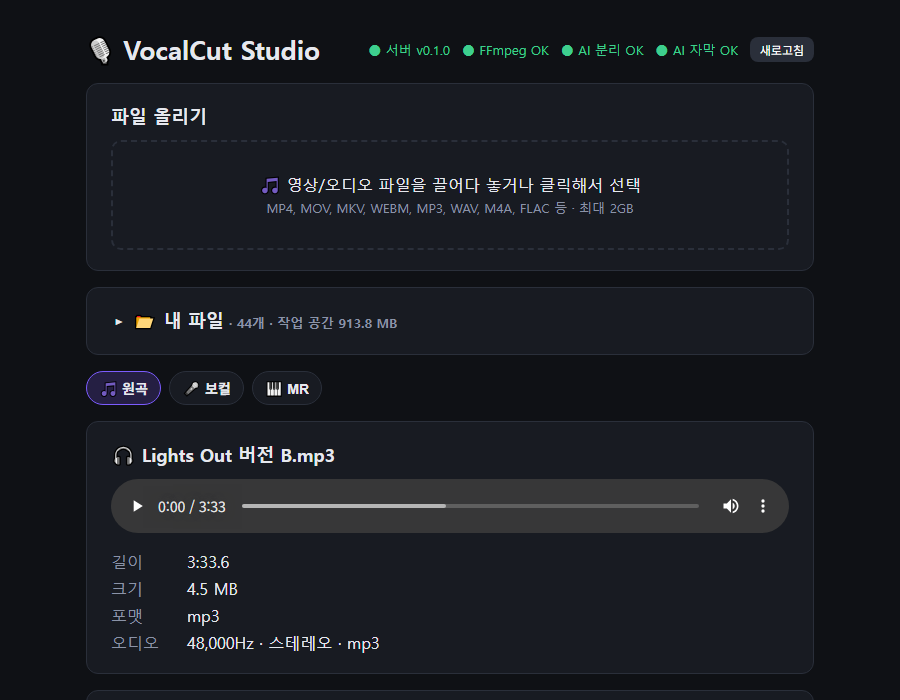
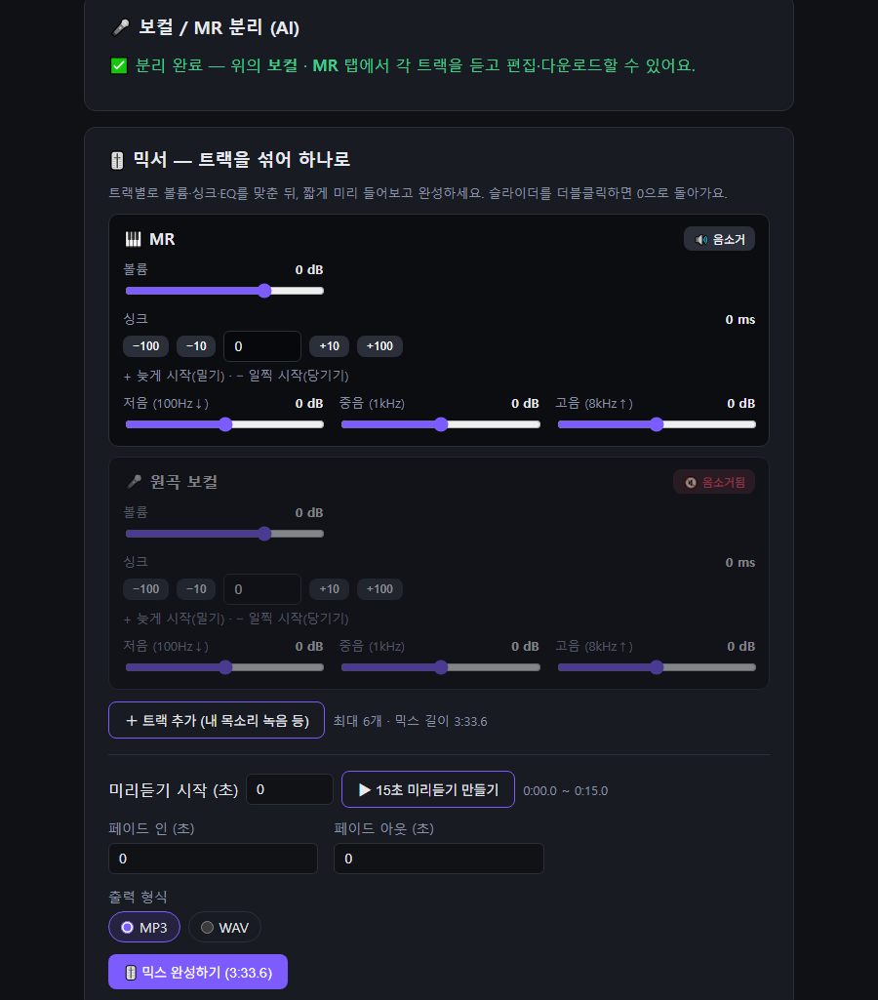
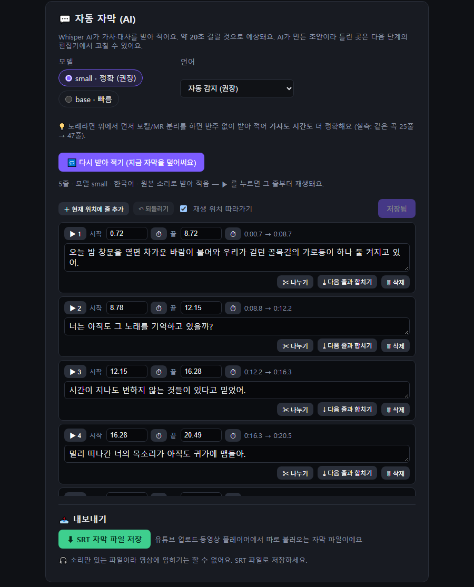
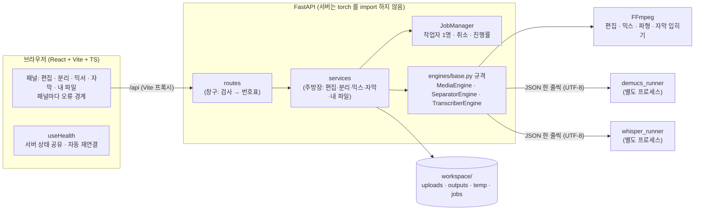

# 🎙️ VocalCut Studio

**저사양 Windows PC(RAM 4GB · GPU 없음)에서 돌아가는 로컬 AI 노래·영상 편집 스튜디오.**
노래에서 보컬과 반주를 AI로 나누고, 내 목소리를 섞어 커버곡을 만들고, 가사 자막을 AI로 받아 적어 영상에 입힌다.
모든 처리는 내 PC 안에서 끝난다 (파일을 외부 서버로 보내지 않음).

> **TL;DR (EN)** — A local, privacy-first AI studio for song covers: Demucs vocal/instrumental separation,
> a multi-track mixer, faster-whisper lyric transcription with an editor, and Korean-safe subtitle burn-in.
> Built with React + FastAPI + FFmpeg and engineered to run on a 4 GB RAM, CPU-only laptop:
> AI runs in isolated subprocesses, audio is processed in constant-memory chunks, and every model/threshold choice is backed by on-device measurements.



## 무엇을 할 수 있나

| 기능 | 설명 |
|---|---|
| ✂️ **편집** | 파형에서 구간을 끌어 선택 → 자르기 · 볼륨 · 페이드 → MP4 / MP3 / WAV |
| 🎤 **AI 보컬/MR 분리** | Demucs(htdemucs)로 목소리와 반주 분리. 30초 조각 처리로 곡 길이와 상관없이 메모리 일정 |
| 🎚️ **믹서** | 트랙별 볼륨 · ms 단위 싱크 · 3밴드 EQ · 리미터 · 15초 미리듣기 → 내 목소리 + MR 커버곡 |
| 💬 **AI 자동 자막** | faster-whisper 받아쓰기. 언어 자동 감지, 분리된 보컬로 받아 적어 정확도 향상 |
| ✏️ **자막 편집기** | 글자·시간 수정, 나누기 · 합치기 · 줄 추가 · 되돌리기, 재생 위치 따라가기 |
| 📤 **내보내기** | SRT 파일, 또는 **영상에 한글 자막 입히기** (글꼴 · 크기 · 위치) |
| 📂 **내 파일** | 원곡 + 보컬/MR + 결과물 + 자막을 한 묶음으로 관리, 다시 열기 · 묶음 삭제 · 용량 보기 |
| 🛟 **안정성** | 작업 대기열 · 취소 · 오류 번호와 로그 · 디스크 공간 확인 · 서버 꺼짐 안내와 자동 재연결 |

<table>
<tr>
<td width="50%"></td>
<td width="50%"><br><br>
</td>
</tr>
<tr>
<td>보컬/MR 분리 → 믹서 (MR + 원곡 보컬 가이드, 트랙 추가로 내 목소리)</td>
<td>AI 가 받아 적은 자막 · 편집기 · 내보내기, 그리고 한글 자막을 입힌 영상의 한 장면 (예시 문장은 직접 쓴 테스트 문장)</td>
</tr>
</table>

## 실행 방법

필수: Windows 10/11, Python 3.11, Node.js 20+, FFmpeg (PATH 등록)

**처음 한 번만 설치:**

```powershell
powershell -ExecutionPolicy Bypass -File .\scripts\setup-backend.ps1   # 백엔드 (.venv)
cd frontend; npm.cmd install; cd ..                                     # 프론트엔드
```

**실행 / 종료: 프로젝트 폴더의 `start.cmd` / `stop.cmd` 를 더블클릭** (또는 아래 명령)

```powershell
.\scripts\start.ps1   # 필수 프로그램 확인 → 서버 2개를 백그라운드로 실행 → 준비되면 브라우저 열기
.\scripts\stop.ps1    # 서버 2개 끄기 (AI 작업 중이면 그 작업도 멈춤)
```

- 화면: http://localhost:5173 · API 문서: http://127.0.0.1:8000/docs · `?file=<id>` 로 특정 파일을 바로 열 수 있다.
- 이미 켜져 있는 서버는 다시 켜지 않는다. 서버는 **창 없이** 돌고, 기록은 `logs\` 에 남는다 (`app.log` 는 계속 쌓임, `backend.log` 는 켤 때마다 새로).
- 서버가 꺼지면 화면 위에 켜는 방법이 안내되고, 다시 켜지면 새로고침 없이 이어진다.
- 개발 중 서버 출력을 직접 보려면 `.\scripts\run-backend.ps1` / `cd frontend; npm.cmd run dev`.

<details>
<summary><b>(선택) AI 기능 설치</b> — 설치하지 않으면 화면에 "AI 분리 없음 / AI 자막 없음"으로 표시되고 나머지는 그대로 동작</summary>

```powershell
cd backend
# 보컬/MR 분리 (PyTorch CPU 버전 + Demucs). 모델 htdemucs 약 81MB 는 처음 분리할 때 자동으로 받는다
.\.venv\Scripts\python.exe -m pip install torch torchaudio --index-url https://download.pytorch.org/whl/cpu
.\.venv\Scripts\python.exe -m pip install -r requirements-ai.txt

# 자동 자막 (PyTorch 불필요, CTranslate2 엔진). 모델 small 약 460MB 는 처음 쓸 때 받는다
.\.venv\Scripts\python.exe -m pip install -r requirements-asr.txt
```

모델은 `backend/models/` 에 저장되고, 한 번 받은 뒤에는 인터넷 없이 동작한다.
</details>

## 아키텍처



- **창구 → 주방장 → 조리기구** 3단 구조: 라우트는 검사와 응답만, 서비스는 업무 흐름, 엔진은 실제 처리.
- **엔진 교체 가능:** `engines/base.py` 의 규격만 지키면 FFmpeg·Demucs·Whisper 를 다른 엔진(상용 모델, 클라우드 API)으로 바꿀 수 있다. 설정(`app/core/config.py`)의 `*_ENGINE` 값으로 선택.
- **무거운 작업은 대기열로:** 요청은 바로 번호표(202)를 받고, 작업자 1명이 순서대로 처리한다 → RAM 4GB PC 에서 AI 두 개가 동시에 돌지 않는다.

## Applied AI 엔지니어링 포인트

이 프로젝트의 핵심은 "모델을 호출하는 것"보다 **제약이 심한 실제 환경에서 AI 기능을 안정적으로 제품화**하는 것이다.

1. **AI 는 별도 프로세스에서** — 서버는 torch·faster-whisper 를 import 하지 않는다. 실행기(runner)가 JSON 한 줄씩 진행률·결과를 보고하고, 끝나면 메모리를 운영체제에 전부 돌려준다. AI 가 메모리 부족으로 죽어도 서버는 멀쩡하다.
2. **곡 길이와 무관한 메모리** — Demucs 를 30초 조각 + 2초 크로스페이드로 처리하고 입력은 memmap 으로 읽는다. 이음매 오차는 이음매 없는 구간과 같은 수준.
3. **추측 대신 실측으로 결정** — 모델 크기(small 기본, base 빠름), VAD 기준(원곡 0.2 / 보컬 0.5), 언어 경고 기준(확신도 0.8)을 전부 이 PC 에서 잰 숫자로 정했다 (`backend/tools/bench_*.py`).
4. **파이프라인 설계로 정확도 향상** — 분리된 보컬로 받아 적으면 같은 곡에서 자막이 25줄 → 47줄, 시작 시간도 실제 노래 시작에 맞는다.
5. **AI 의 실패 모드 대비** — 반주만 있는 구간의 환각("고맙습니다")은 VAD 로, 반복 환각은 `condition_on_previous_text=False` 로, 언어 오설정은 별도 언어 감지 + 경고로 막고, 남는 오류는 사람이 고치는 편집기를 전제로 한다 ("AI 초안 + 사람 수정").
6. **취소·진행률·예상 시간** — 0.5초 heartbeat 로 취소가 1~2초 안에 반영되고(자식 프로세스까지 종료), 분리 예상 시간은 이 PC 의 최근 실제 기록 중앙값으로 계산한다.
7. **AI 없이 테스트** — 진짜 실행기와 같은 통신 규칙을 쓰는 가짜 실행기로 성공·메모리 부족·비정상 종료·취소·한글 인코딩까지 몇 초 만에 검사한다 → CI 에서도 모델 없이 돈다.

## 실측 데이터 (i5-4200M · RAM 3.9GB · GPU 없음)

**보컬/MR 분리 (Demucs htdemucs)**

| 방식 | 최대 메모리 | 비고 |
|---|---|---|
| 곡 전체를 한 번에 (기본) | 30초 753MB · 60초 1,048MB → 2분 곡 약 1.6GB (추정) | 곡 길이에 비례 |
| **30초 조각 + 2초 크로스페이드** | **2분 곡 813MB, 곡 길이와 무관** | 처리 시간: 곡 길이의 약 2.4~3.1배 |

**자동 자막 (faster-whisper, CPU int8)**

| 모델 | 최대 메모리 | 속도 (곡 길이 대비) | 한국어 글자 오류율 (음성 / 음성+반주) |
|---|---|---|---|
| tiny | 250MB | 0.15~0.4배 | 6.1% / 8.7% |
| base (빠름) | 325MB | 0.25~0.35배 | 5.2% / 2.6% |
| **small (기본)** | 580~710MB | 0.3~0.8배 | **0.9% / 1.7%** |

한국어 오류율은 정답을 아는 합성 음성으로 측정했다. 노래는 이보다 어렵기 때문에 편집기를 함께 둔다.

**실제 곡 종단 테스트** — 업로드 → 원곡 자막 → 분리 → 보컬 자막 → 편집 저장 → SRT → 영상에 입히기를 실제 서버 API 로 실행

| 단계 | Lights Out A (3:28) | Lights Out B (3:34) |
|---|---|---|
| 원곡으로 자막 (small) | 25줄 · 101초 | 25줄 · 62초 |
| 보컬/MR 분리 | 8분 45초 | 8분 22초 |
| **보컬로 자막 (small)** | **32줄** · 76초 | **47줄** · 80초 |
| SRT / 영상에 입히기 (1280×720) | 33블록 · 34초 | 48블록 · 34초 |

언어 자동 감지 2/2 정답, 반복 환각 줄 0개, 15초 넘게 비는 구간 0개.

## 문제 해결 기록

개발하면서 실제로 부딪힌 문제와, 원인을 찾아 고친 과정.

| 증상 | 원인 | 해결 |
|---|---|---|
| AI 는 "6줄 받아 적음"이라는데 화면에 글자가 0개 | 실행기가 파이프로 출력할 때 윈도우가 **cp949** 로 인코딩 → 서버가 UTF-8 로 못 읽어 한글 줄을 버림 (Demucs 실행기에도 숨어 있던 문제) | 공통 `emit()` 이 항상 UTF-8 바이트로 쓰게 하고, 한글 가사를 보내는 가짜 실행기로 회귀 테스트 |
| 3분 33초 곡의 자막이 **0:39에서 멈춤** | 영어 노래를 '한국어'로 받아 적게 함 → Whisper 가 중간에 포기 | 기본값을 자동 감지로, 언어를 따로 감지해 다르면 경고 (끝 3:26까지) |
| 원곡에서 노래를 많이 놓침 (10줄) | VAD 가 반주 위의 노래를 '목소리 아님'으로 판단 | 원곡만 VAD 기준 0.5 → 0.2 (26줄). MR 만 넣으면 여전히 0줄 = 환각 없음 |
| 언어 감지 결과가 항상 비어 있음 | `transcribe()` 는 dict 를 받지만 `detect_language()` 는 `VadOptions` 객체만 받음 + 내 코드가 오류를 **조용히 삼킴** | 형식 맞춤, 감지 실패를 로그에 남기도록 변경 |
| 페이드 테스트가 이유 없이 실패 → 기준을 낮췄었음 | 측정 도구(`-ss/-t`)가 약 0.09초 덩어리 단위로 읽어 경계 밖 소리가 섞임 | `atrim` 으로 측정 → 원래 기준(20dB) 복구. **"코드가 틀렸나" 전에 "측정이 맞나"** |
| 분리 취소가 10~16초 걸림 / 임시 파일 남음 | 보고가 없는 동안 취소를 확인하지 못함 · `.venv` python 은 런처라 자식이 살아남음 · 윈도우 파일 잠금 | 보고 받기를 별도 스레드로 + 0.5초 heartbeat (→ 1.5초), `taskkill /T` 로 가족 전체 종료, 삭제 재시도 |
| 싱크 버튼 +100 +100 −10 을 빠르게 누르면 결과가 −10 | stale closure: 다시 그려지기 전의 옛 값으로 계산 | 함수형 업데이트 / ref 로 항상 최신 값 사용 (+180 정확) |
| 'base' 를 골랐는데 small 로 받아 적음 | StrictMode 에서 상태 요청이 두 번 → 늦게 온 응답이 사용자 선택을 덮어씀 | 사용자가 고른 값은 덮어쓰지 않음 + 서버 상태를 한 곳(`useHealth`)에서 공유 |
| 자막을 영상에 입히면 깨지거나 □□□ | FFmpeg 필터 안의 `C:\...` 경로 이스케이프 · 글꼴 미지정 | 자막 폴더 안에서 실행해 필터엔 짧은 이름만, 글꼴 파일을 직접 전달. libass 기록으로 "빠진 글자 없음" 테스트 |
| `start` 를 눌러도 파란 빈 창 + 서버 연결 안 됨 | 콘솔 창 안을 클릭하면 '빠른 편집' 선택 모드로 **창 안의 서버가 멈춤** · `cmd` 창은 아예 실행되지 않는 환경 | 서버를 창 없는 백그라운드 프로세스로 실행하고 출력은 `logs\` 로, 실패 시 로그 끝부분 표시 |
| 예상 못 한 서버 오류 시 화면에 "요청 실패 (HTTP 500)" | 기본 응답은 JSON 이 아닌 영어 한 줄 / 백엔드가 꺼지면 프록시가 빈 500 | 한국어 안내 + 오류 번호(로그에 같은 번호), 빈 500 은 "서버에 연결할 수 없음"으로 |

## 테스트와 품질

```powershell
# 백엔드 170개 + 코드 검사
cd backend
.\.venv\Scripts\python.exe -m pip install -r requirements-dev.txt   # 최초 1회
.\.venv\Scripts\python.exe -m pytest -q
.\.venv\Scripts\python.exe -m ruff check .

# 프론트엔드: 타입 검사 + 자막 편집 순수 함수 10개 (vitest)
cd frontend
npx tsc -b
npm.cmd test
```

- **실제 소리로 검증:** 테스트용 음원·영상은 FFmpeg 로 즉석 생성하고, 볼륨·페이드·싱크·EQ·리미터는 `volumedetect` 로 실제 음량을 재서 확인한다.
- **AI 는 가짜 실행기로:** 성공 · 메모리 부족 · 비정상 종료 · 응답 없는 상태에서의 취소 · 한글 인코딩.
- **자막 입히기는 실제 프레임으로:** 자막이 나오는 동안만 흰 글자가 있는지 세고, libass 기록으로 한글 글꼴 선택을 확인한다.
- **실패 상황:** 예상 못 한 오류의 응답 형식과 로그, 디스크 부족 시 507, 작업 중 삭제 금지, 서버 시작 정리 범위.
- **CI:** `.github/workflows/ci.yml` — push/PR 마다 Linux 에서 ruff · pytest · tsc · vitest (AI 패키지 없이, 윈도우 전용 글꼴 검사는 자동 건너뜀).

## 설계 원칙

- **사용자 파일은 절대 자동으로 지우지 않는다.** 서버 시작 때 정리하는 것은 강제 종료로 남은 `temp/` 와 30일 지난 작업 기록뿐. 삭제는 사용자가 확인한 뒤 묶음째로.
- **실패해도 이유와 다음 행동을 알려준다.** 메모리 부족이면 "브라우저 탭을 닫거나 '빠름' 모델로", 디스크 부족이면 시작 전에 필요한 용량과 정리 방법을.
- **보안:** 파일 id 는 32자리 16진수만 허용(경로 조작 방지), 사용자가 보낸 파일 이름은 경로에 쓰지 않음, 내부 경로·원인은 화면에 노출하지 않고 로그에만.
- **한글 우선:** UTF-8 실행기 통신, SRT 는 BOM 포함, 한글 파일 이름 다운로드(`filename*`), 자막 글꼴 직접 지정.

## 프로젝트 구조

```
frontend/src/
  api/          서버 통신 함수 (화면은 fetch 를 직접 쓰지 않음)
  features/     패널별 화면: editor · separation · mixer · subtitles · library · health …
  hooks/        useHealth (서버 상태 공유) · useElapsed
backend/app/
  api/routes/   창구: files · edits · separations · mixes · subtitles · library · jobs · health
  services/     주방장: 편집 · 분리 · 믹스 · 자막(받아쓰기·편집·SRT/ASS·입히기) · 내 파일 · 디스크 확인
  services/engines/
    base.py       엔진 규격 (교체 가능)
    media/        FFmpeg 엔진
    separator/    Demucs 조종기 + 실행기(별도 프로세스) + 조각 처리
    transcriber/  Whisper 조종기 + 실행기(별도 프로세스)
    runner_client.py · runner_utils.py   실행기 공통 부품 (JSON 통신 · 취소 · 메모리 측정)
  jobs/         작업 대기열 (작업자 1명 · 취소 · 재시작 시 '중단됨' 표시)
backend/tests/  pytest 170개 (+ fakes/ 가짜 실행기)
backend/tools/  실측 도구: bench_separation.py · bench_transcription.py
scripts/        설치 · 실행 · 종료 (start.cmd / stop.cmd 는 더블클릭용)
```

## 한계와 다음 계획

- **한계:** 노래 받아쓰기는 늘어지는 발음·반복 후렴에서 여전히 틀린다 (편집기로 보완). CPU 전용이라 분리는 곡 길이의 2~3배가 걸린다. Windows 기준으로 만들었다 (스크립트·글꼴 경로).
- **Phase 2:** 무음 구간 자동 컷, 잡음 제거.
- **Phase 3:** 멀티트랙 타임라인, GPU 가속과 CPU 대체 경로, Electron/Tauri 설치 파일 (모델은 따로 내려받기).

## ⚠️ 라이선스 메모

- Demucs **코드**는 MIT. 사전학습 **가중치**는 연구용 데이터셋으로 학습되어, 유료 판매 전 상업 이용이 가능한 모델로 교체를 검토해야 한다.
- faster-whisper 코드와 Whisper 모델 가중치는 MIT (상업 이용 가능).
- 자막 글꼴 '맑은 고딕'은 윈도우 기본 글꼴 → 배포용 결과물에는 나눔고딕 · Noto Sans KR(OFL) 같은 자유 글꼴로 교체 검토.
- FFmpeg full build 는 GPL 구성 요소를 포함 → 배포 시 LGPL 빌드 또는 대체 엔진 검토.
